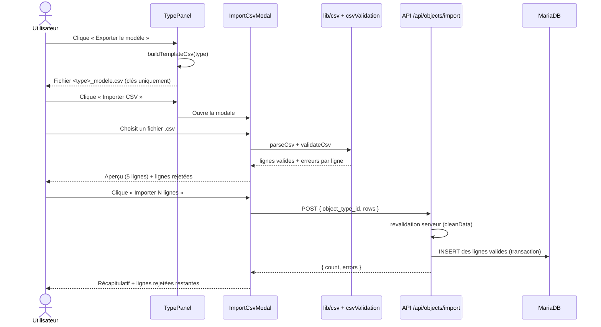
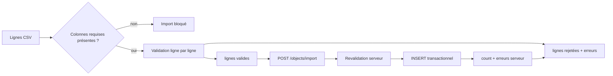

# Import / export CSV des objets

Fonctionnalité disponible sur la page d'inventaire (`/`), dans l'en-tête de chaque
panneau de type, à côté du bouton « Ajouter un objet ».

## 1. Parcours utilisateur



## 2. Modèle CSV exporté

Le modèle contient les **clés en en-tête** et **une ligne d'exemple concrète**
(aucune donnée réelle de l'inventaire n'est exportée).

- Colonne obligatoire : `name` (nom de l'objet).
- Une colonne par champ du gabarit, dans l'ordre `sort_order`, identifiée par sa
  **clé technique** (`field_key`, ex. `adresse_mac`, `etat`).
- Séparateur `;` (compatible Excel français), BOM UTF-8 ajouté au téléchargement,
  fin de ligne `\n`.
- Nom de fichier : `<slug du type>_modele.csv` (via `slugifyKey`).

Exemple pour le type « Serveur » :

```csv
name;adresse_ip;adresse_mac;os;cpu;ram;stockage;numero_de_serie;emplacement;etat
Serveur-01;192.168.1.10;AA:BB:CC:DD:EE:01;Debian 12;Intel Core i5;16 Go;512 Go SSD;SN123456789;Salle 12;Neuf
```

### Valeurs d'exemple proposées

| `input_type` | Valeur |
| --- | --- |
| `text` | `SN123456789`, `Debian 12`, `Salle 12`… selon la clé, sinon `Exemple` |
| `number` | `24` (`3` pour `nombre_de_boutons`) |
| `date` | date du jour au format `AAAA-MM-JJ` |
| `mac` | `AA:BB:CC:DD:EE:01` |
| `ip` | `192.168.1.10` |
| `select` | première option définie dans le gabarit |
| `boolean` | `Oui` |

Le nom suggéré est `<type>-01`. La ligne d'exemple respecte le gabarit : elle
peut être importée telle quelle pour vérifier le modèle.

## 3. Lecture du CSV

`frontend/app/lib/csv.ts` :

- `parseCsv` : retire le BOM, détecte le séparateur (`;`, `,` ou tabulation)
  sur la première ligne non vide, gère les champs entre guillemets, les guillemets
  doublés, les retours à la ligne `\n` / `\r\n` et conserve le **numéro de ligne
  d'origine** (en-tête = ligne 1).
- `buildTemplateCsv` / `downloadCsv` : génération et téléchargement du modèle.

## 4. Validation

`frontend/app/lib/csvValidation.ts` applique les règles du gabarit **avant**
l'envoi :

| Élément | Règle |
| --- | --- |
| En-têtes | `name` et les clés des champs `is_required` doivent être présents, sinon l'import est bloqué. Les colonnes inconnues sont signalées puis ignorées. |
| `name` | Non vide. |
| Champs requis | Valeur non vide, sinon la ligne est rejetée. |
| `select` | Valeur exactement parmi `options` (chaîne JSON ou tableau acceptés). |
| `boolean` | `vrai` : `oui` / `yes` / `true` / `1` ; `faux` : `non` / `no` / `false` / `0`. |
| `number` | Nombre fini. |
| `date` | Date interprétable. |
| `mac` | Format `AA:BB:CC:DD:EE:FF` (ou tirets). |
| `ip` | Adresse IPv4 valide. |

Les valeurs converties (`number`, `boolean`) sont envoyées typées à l'API.
Chaque erreur est affichée avec son numéro de ligne ; une ligne peut cumuler
plusieurs erreurs.



## 5. Contrat API

Nouvelle route : `POST /api/objects/import` (JWT requis).

```json
{
  "object_type_id": 3,
  "rows": [
    { "name": "SRV-01", "data": { "adresse_ip": "192.168.0.10", "etat": "Neuf" } }
  ]
}
```

Réponse :

```json
{
  "count": 1,
  "errors": [{ "row": 2, "error": "Champ « Adresse IP » : adresse IP invalide." }]
}
```

- `row` est l'index **1-based dans le tableau envoyé** ; la modale le traduit en
  numéro de ligne CSV d'origine.
- Les lignes invalides sont ignorées, les lignes valides sont insérées dans une
  seule transaction.
- Limites : 500 lignes par import, corps JSON porté à 2 Mo.
- La validation des options (`select`) a aussi été ajoutée à `cleanData` : elle
  s'applique désormais à la création et à la modification classiques d'objets.

## 6. Fichiers concernés

| Fichier | Rôle |
| --- | --- |
| `backend/routes/objectRoutes.ts` | Route `POST /import` et garde-fous |
| `backend/services/objectService.ts` | `importObjects`, options validées dans `cleanData` |
| `backend/models/types.ts` | Types de la requête / réponse d'import |
| `backend/server.ts` | Limite du corps JSON à 2 Mo |
| `frontend/app/lib/csv.ts` | Parse / template / téléchargement |
| `frontend/app/lib/csvValidation.ts` | Validation côté navigateur |
| `frontend/app/components/ImportCsvModal.tsx` | Modale, aperçu et erreurs |
| `frontend/app/components/TypePanel.tsx` | Boutons « Importer CSV » / « Exporter le modèle » |
| `frontend/app/hooks/useInventory.ts` | `importObjects` + rechargement de l'inventaire |
| `frontend/app/services/objectService.ts` | Appel à la route d'import |
